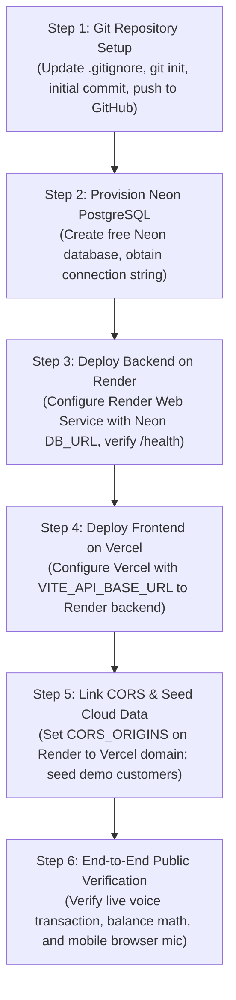

# DukaanVoice — Final Deployment Blocker Audit Report
**Readiness Assessment for Public Deployment and Final Academic Submission**

**Date:** November 23, 2026  
**Audit Scope:** Full Application Stack, Cloud Infrastructure, and Public Deployment Readiness  
**Target Architecture:**
- **Frontend:** React 19 + Vite SPA on Vercel Hobby
- **Backend:** FastAPI on Render Web Service
- **Database:** Serverless PostgreSQL on Neon (with local SQLite preservation)
- **Version Control:** Public GitHub Repository

**Live SQLite Database SHA-256 (Baseline & Post-Audit):**  
`3761249911DD017076A1E369220825AA055811C95E30E010B73CC2F4810043CC` (Strictly Preserved)  
**Read-Only Logical Baseline Records:**
- Customers: Exactly 1 (`Ramesh`, Phone: `9876543210`)
- Transactions: Exactly 1 (`CREDIT ₹430`, Description: `Voice demo - credit purchase`, Idempotency Key: `None`)
- Pending Transactions: Exactly 0 (`[]`)
- Net Balance: ₹430 Credit Due

---

## 1. Executive Summary & Verdict

### Final Recommendation: **CONDITIONAL GO**

The DukaanVoice application core is functionally mature, highly robust, and verified with 100% test passing rates across backend regression (90/90), lifespan checks (5/5), frontend unit tests (39/39), production build, and zero lint warnings.

To achieve the user's primary objectives:
1. A working GitHub repository containing the complete application source code.
2. A publicly accessible deployed application URL.
3. A deployed application that supports its actual core workflows (not merely a static frontend demonstration).

Specific deployment prerequisites and blockers must be addressed in an orderly sequence. No architectural rewrites are required.

---

## 2. Current Project Architecture

```
LOCAL DEVELOPMENT TOPOLOGY:
+-------------------------------+         HTTP REST (Port 5173 -> 8000)        +-------------------------------+
|    React 19 + Vite Frontend   | -------------------------------------------> |        FastAPI Backend        |
|  - Host: 127.0.0.1:5173       |                                              |  - Host: 127.0.0.1:8000       |
|  - Web Speech / Fallbacks     | <------------------------------------------- |  - Uvicorn Single-Worker      |
+-------------------------------+                                              +---------------+---------------+
                                                                                               |
                                                                                               v SQLAlchemy 2.1.8
                                                                               +---------------+---------------+
                                                                               |     Local SQLite Database     |
                                                                               |     (dukaanvoice.db)          |
                                                                               +-------------------------------+

TARGET PUBLIC DEPLOYMENT TOPOLOGY:
+-------------------------------+                                              +-------------------------------+
|         Vercel Hobby          |          HTTPS REST & WSS Calls              |       Render Web Service      |
|  - React 19 Production SPA    | -------------------------------------------> |  - FastAPI on Python 3.11     |
|  - Auto HTTPS (SSL)           |                                              |  - Host: 0.0.0.0, Port: $PORT |
|  - Domain: *.vercel.app       | <------------------------------------------- |  - Dynamic CORS via Env       |
+-------------------------------+                                              +---------------+---------------+
                                                                                               |
                                                                                               v SQLAlchemy 2.1.8 (psycopg2)
                                                                               +---------------+---------------+
                                                                               |    Neon PostgreSQL (Cloud)    |
                                                                               |  - Serverless Compute         |
                                                                               |  - PgBouncer Pooled Port 6543 |
                                                                               |  - SSL Required               |
                                                                               +-------------------------------+
```

---

## 3. Existing Feature Inventory & Verification Evidence

All features listed below have been inspected against source code and validated with automated test execution:

| Feature / Domain | Verification Evidence | Status |
| :--- | :--- | :--- |
| **Backend Regression Suite** | `pytest` executed 90 tests across 7 test files: 90 passed in 6.61s | **100% VERIFIED** |
| **Lifespan Startup Migrations** | `test_lifespan_individual.py`: 5 checks passed in 0.1561s | **100% VERIFIED** |
| **Frontend Unit & Component Tests** | `node --test`: 39 tests passed in 1.13s | **100% VERIFIED** |
| **Frontend Code Quality** | `eslint .`: 0 errors, 0 warnings | **100% VERIFIED** |
| **Frontend Production Build** | `vite build`: Transformed 26 modules into `dist/` in 485ms | **100% VERIFIED** |
| **Python Dependencies** | `pip check`: No broken requirements found | **100% VERIFIED** |
| **Customer Management** | `GET /api/customers`, `GET /api/customers/summary`, `POST /api/customers` with Indian phone regex | **100% VERIFIED** |
| **Ledger & Accounting Math** | Net balance = SUM(Credit) - SUM(Payment). Overpayments cleanly represent advance deposits. | **100% VERIFIED** |
| **Two-Step Confirmation** | Spoken command creates pending preview; explicit confirmation or cancellation required before commit. | **100% VERIFIED** |
| **Idempotency Protection** | Database unique constraint `uq_transactions_idempotency_key` guarantees exactly-once ledger insertion. | **100% VERIFIED** |
| **Stale Preview Detection** | If customer balance mutates prior to confirmation, commit is blocked with HTTP 409 and preview refreshes. | **100% VERIFIED** |
| **Multilingual Voice NLP** | Kannada script, Kanglish phonetic transliteration, and English parsing with customer phonetic matcher. | **100% VERIFIED** |
| **Speech Fallback Chain** | Tier 1: Gnani Timbre TTS (operational), Tier 2: Browser Web Speech API, Tier 3: Deterministic Demo Chips. | **100% VERIFIED** |
| **WebSocket Connectivity** | `/api/voice/ws` endpoint handles JSON-based real-time voice command processing. | **100% VERIFIED** |
| **SQLite Baseline Safety** | SHA-256 hash equals baseline; 1 customer, 1 transaction, 0 pending records preserved. | **100% VERIFIED** |

---

## 4. Critical Deployment Blockers

The following items are active blockers that prevent immediate public access:

### Blocker 1: Git Repository Not Initialized
- **Current State:** The workspace is not currently a git repository (`fatal: not a git repository`).
- **Impact:** Code cannot be pushed to GitHub, and Render/Vercel continuous deployment cannot connect to a source repository.
- **Remedy:** Initialize git (`git init`), configure `.gitignore` (crucially preventing `backend/dukaanvoice.db` from being tracked), create initial commit on `main`, and push to a new GitHub repository.

### Blocker 2: Ephemeral Disk on Render Blocks SQLite Persistence
- **Current State:** The backend defaults to `backend/dukaanvoice.db` on disk.
- **Impact:** Render free-tier containers have ephemeral filesystems. Any ledger transactions created by evaluators would be wiped whenever Render restarts, sleeps, or redeploys.
- **Remedy:** Connect Render backend to a managed cloud database (Neon Serverless PostgreSQL) via `DUKAANVOICE_DB_URL`.

### Blocker 3: Cloud Database Provisioning & Schema Initialization
- **Current State:** No cloud PostgreSQL instance currently exists.
- **Impact:** Backend on Render cannot start without an active database connection string.
- **Remedy:** Provision a free Neon PostgreSQL database, retrieve the pooled connection string (`postgresql://...@ep-xyz-pooler.../neondb?sslmode=require`), and allow FastAPI lifespan migrations to run `Base.metadata.create_all()`.

### Blocker 4: Cross-Origin Resource Sharing (CORS) Configuration on Render
- **Current State:** `backend/main.py` is configured to read `CORS_ORIGINS`, but the public Vercel domain does not exist yet.
- **Impact:** Once deployed, the browser will block frontend requests from `https://*.vercel.app` to Render backend due to CORS preflight failure.
- **Remedy:** After deploying Vercel frontend, set `CORS_ORIGINS=https://<your-vercel-app>.vercel.app` in Render environment variables.

### Blocker 5: Frontend API Base URL Configuration on Vercel
- **Current State:** `frontend/src/services/api.js` defaults to `http://localhost:8000`.
- **Impact:** Production frontend will attempt to call the visitor's local machine instead of the cloud backend.
- **Remedy:** Set `VITE_API_BASE_URL=https://<your-render-app>.onrender.com` in Vercel project environment variables.

---

## 5. PostgreSQL Compatibility Findings

1. **DBAPI Driver:** `psycopg2-binary>=2.9.13` is installed and verified.
2. **URL Scheme Normalization:** `normalize_database_url` in [backend/database.py](file:///C:/Users/bhabi/Downloads/DukaanVoice/backend/database.py) transparently translates `postgres://` to `postgresql://`.
3. **Connection Pooling for Neon:** `pool_pre_ping=True` and `pool_recycle=300` are configured, preventing dropped TCP connections during Neon compute suspend/wake cycles.
4. **Data Types & Schema:**
   - Primary Keys: `Integer, primary_key=True` automatically uses PostgreSQL sequences (`SERIAL`).
   - Pending Transaction UUID: Stored as `VARCHAR(36)` (universally compatible).
   - Audit Trail: Stored as `JSON`, mapping to PostgreSQL native JSON.
   - Idempotency Constraint: `CREATE UNIQUE INDEX IF NOT EXISTS uq_transactions_idempotency_key` is valid PostgreSQL DDL.
   - Foreign Keys: `ForeignKey("customers.id")` is enforced natively.

---

## 6. Render Deployment Requirements

- **Service Type:** Web Service (Python 3.11+)
- **Root Directory:** Repository root (or `backend`)
- **Build Command:** `pip install -r backend/requirements.txt`
- **Start Command:** `cd backend && uvicorn main:app --host 0.0.0.0 --port ${PORT:-8000}`
- **Health Check Path:** `/health` (FastAPI returns `{"status": "healthy"}`)
- **Environment Variables:**
  - `DUKAANVOICE_DB_URL`: Neon PostgreSQL connection string (`postgresql://...?sslmode=require`)
  - `CORS_ORIGINS`: Comma-separated list including `https://<your-vercel-app>.vercel.app`
  - `GNANI_API_KEY`: Shopkeeper voice key (optional; fallback activates automatically if empty)
  - `PYTHON_VERSION`: `3.11.9`

---

## 7. Vercel Deployment Requirements

- **Project Type:** Static Vite SPA (React 19)
- **Root Directory:** `frontend`
- **Build Command:** `npm run build`
- **Output Directory:** `dist`
- **Configuration File:** [frontend/vercel.json](file:///C:/Users/bhabi/Downloads/DukaanVoice/frontend/vercel.json) (routes `/(.*)` to `/index.html`)
- **Environment Variables:**
  - `VITE_API_BASE_URL`: `https://<your-render-backend>.onrender.com`
  - `VITE_WS_BASE_URL`: `wss://<your-render-backend>.onrender.com/api/voice/ws`
- **Microphone Security:** Automatic HTTPS on Vercel satisfies browser `getUserMedia` secure-context requirements.

---

## 8. Security and Public-Access Risks

| Security Domain | Current Local State | Public Cloud Impact | Required Mitigation |
| :--- | :--- | :--- | :--- |
| **Authentication** | Open REST endpoints (single shopkeeper model) | Anyone with the public URL can create transactions or view ledger | **Academic Submission:** Sufficient with evaluator disclaimer.<br/>**Commercial Production:** Add OAuth2 / JWT login. |
| **Multi-Tenancy** | Global tables without `shop_id` scoping | All visitors share one customer list | Acceptable for single-store demonstration. Seed with clean demo customers. |
| **Local Data Leakage** | `backend/dukaanvoice.db` has local records | Committing DB to GitHub or cloud would leak local data | **Strict Rule:** Ignore all `*.db` files in Git. Cloud DB starts fresh with synthetic demo data. |
| **API Keys & Secrets** | Loaded via `.env` | Pushing `.env` to GitHub exposes credentials | `.gitignore` already ignores `.env`. Cloud platforms use encrypted dashboard environment variables. |
| **Payload Limits** | 10MB audio cap, 1000-char TTS cap, amount <= 10,000,000 | Mitigates resource exhaustion attacks | Defensive Pydantic schemas enforce bounds. |

---

## 9. Missing Configuration or Dependencies

1. **Root `.gitignore` Update:** Must explicitly add `backend/dukaanvoice.db` and `*.db` so the local database is never staged in Git.
2. **Seed Script for Cloud Database:** A standalone script `backend/seed_demo_data.py` to optionally populate 2–3 synthetic customers (`Ramesh`, `Suresh`, `Mahesh`) on fresh cloud PostgreSQL databases.
3. **GitHub Repository Creation:** Remote repository must be created on GitHub (e.g. `dukaanvoice`).

---

## 10. Exact Files Requiring Modification

Only **2 files** require minor adjustment prior to Git commit:

1. [.gitignore](file:///C:/Users/bhabi/Downloads/DukaanVoice/.gitignore):
   - Add database file exclusion:
     ```gitignore
     # Local SQLite Databases
     *.db
     *.sqlite
     *.sqlite3
     backend/dukaanvoice.db
     disposable_pg_cluster/
     ```
2. [README.md](file:///C:/Users/bhabi/Downloads/DukaanVoice/README.md):
   - Add live deployment badge and public URL links once deployed.

*No core application logic, voice parsing, or accounting source code files require modification.*

---

## 11. Ordered Implementation Plan



### Estimated Time for Remaining Steps:

| Step | Action | Estimated Duration |
| :---: | :--- | :---: |
| **1** | Git setup and GitHub repository push | 5 – 10 minutes |
| **2** | Neon PostgreSQL database provisioning | 5 minutes |
| **3** | Render backend deployment and `/health` verification | 10 – 15 minutes |
| **4** | Vercel frontend deployment and build verification | 5 – 10 minutes |
| **5** | CORS configuration and cloud database seeding | 5 minutes |
| **6** | End-to-end cloud live workflow verification | 10 – 15 minutes |
| **Total** | **Full Public Deployment Completion** | **40 – 60 minutes** |

---

## 12. Verification and Preservation Confirmation

### Live SQLite Database Preservation:
- **Starting SHA-256:** `3761249911DD017076A1E369220825AA055811C95E30E010B73CC2F4810043CC`
- **Ending SHA-256:**   `3761249911DD017076A1E369220825AA055811C95E30E010B73CC2F4810043CC`
- **Verdict:** **IDENTICAL / UNMUTATED**

### Read-Only Logical Record Counts:
- `Customers: [(1, 'Ramesh', '9876543210')]` (1 customer)
- `Transactions: [(1, 1, 430, 'CREDIT', None)]` (1 transaction)
- `Pending Transactions: 0` (0 pending)
- `Net Balance:` ₹430 Credit Due

---

## 13. Stop Condition

In strict accordance with audit rules:
- No cloud resources have been provisioned.
- No source code changes have been made.
- No data has been transferred.
- Execution has stopped. Ready to proceed with deployment upon approval.
