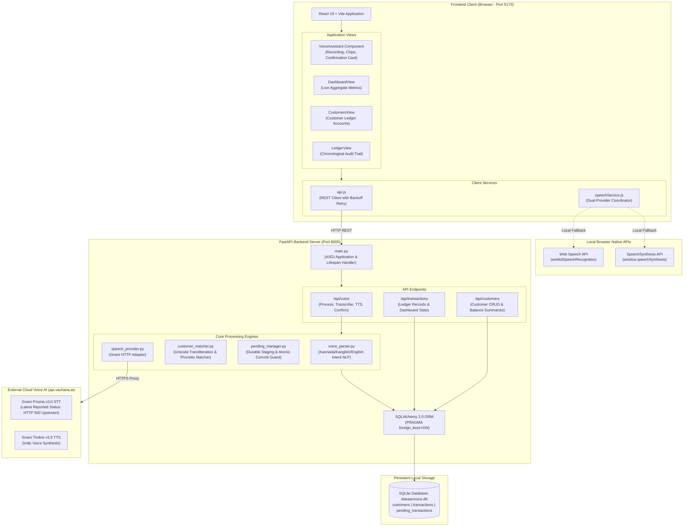
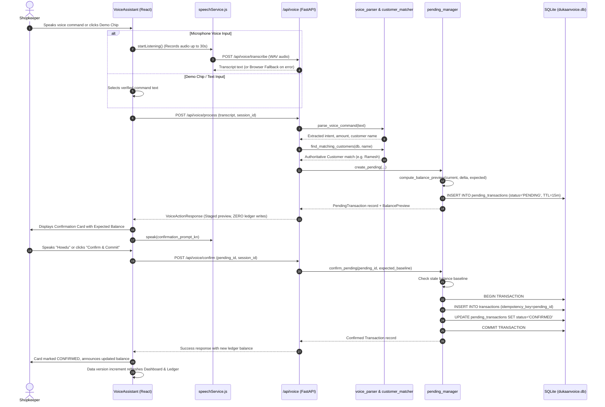
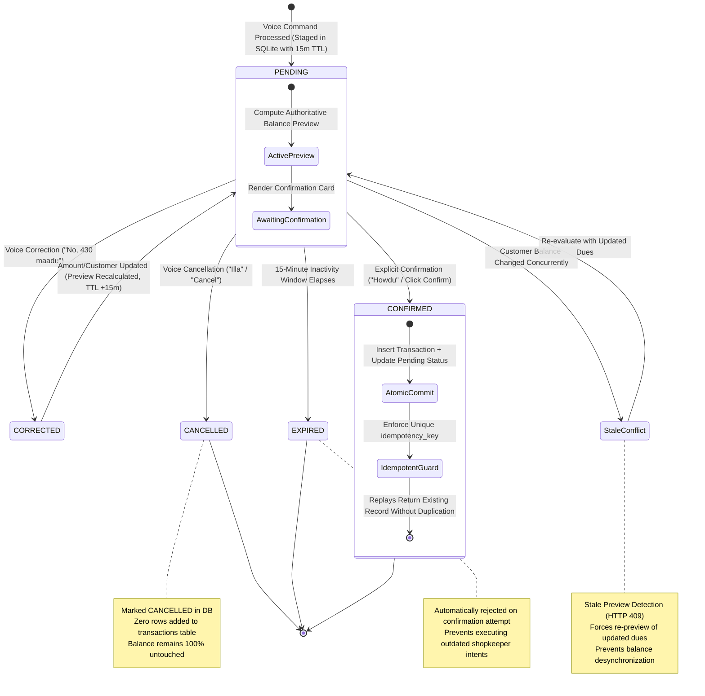
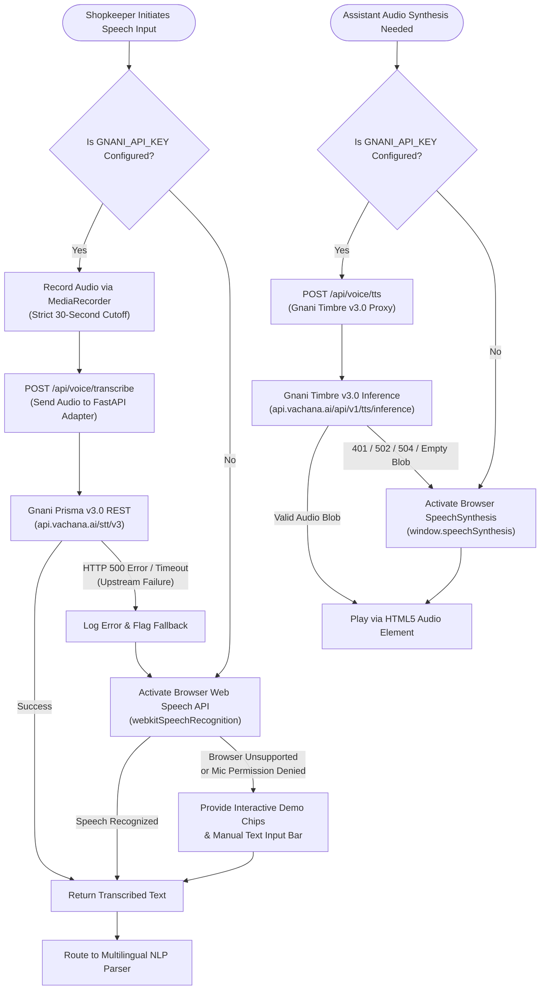
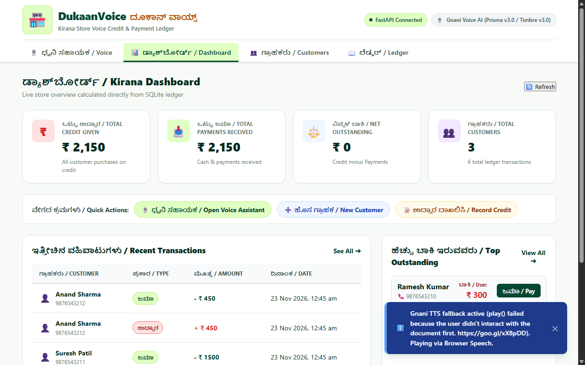
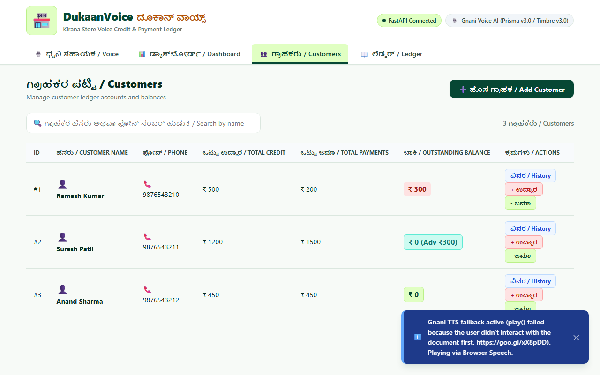
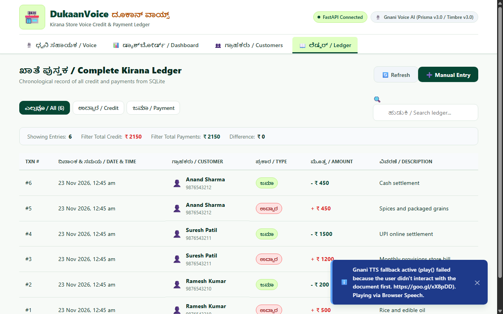
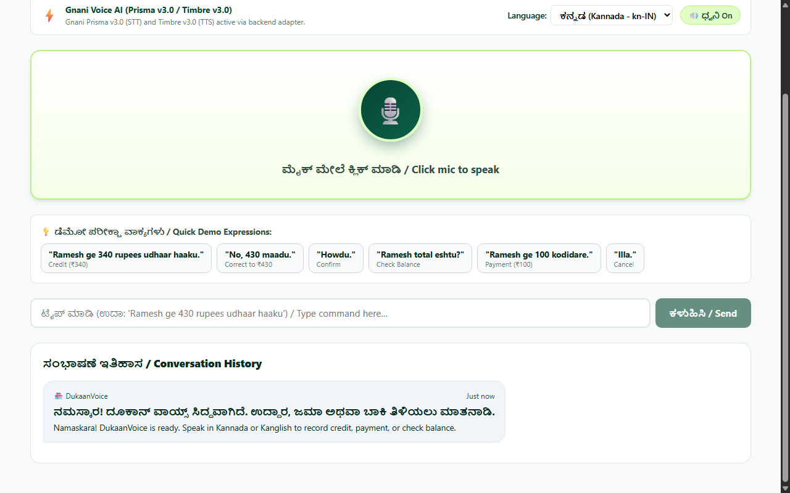
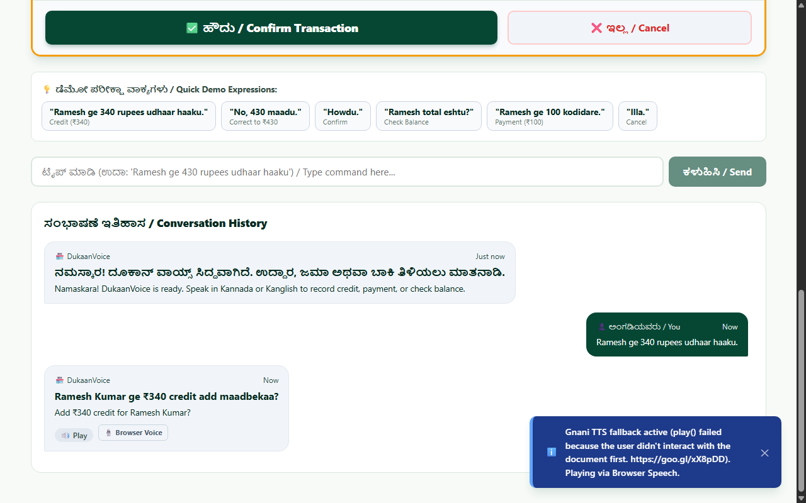

# DukaanVoice

Voice-powered credit (*udhaar*) and payment (*jama*) ledger for kirana shopkeepers, built for the **BolBharat Gnani Voice AI Innovation Challenge**.

---

## 1. Overview

DukaanVoice enables local Indian shopkeepers to manage customer credit accounts using natural Kannada, Kanglish, and English voice commands. Designed for fast-paced retail counters, the application ensures high financial accuracy through a mandatory two-step voice confirmation protocol, real-time pending transaction staging, and instant balance updates.

### Key Capabilities
- **Voice-First Accounting:** Record credits (*udhaar*) and payments (*jama*) hands-free using natural speech in Kannada, Kanglish, and English.
- **Gnani Voice AI Integration:** Native support for **Gnani Prisma v3.0** Speech-to-Text (STT) and **Gnani Timbre v3.0** Text-to-Speech (TTS) via official `https://api.vachana.ai` endpoints.
- **Resilient Fallback:** Seamless automatic fallback to Browser Web Speech API (`webkitSpeechRecognition` / `speechSynthesis`) when external voice APIs are unconfigured or unavailable.
- **2-Step Confirmation Safeguard:** Voice transactions are staged durably in the database as pending. No ledger write occurs until the shopkeeper explicitly confirms (`"Howdu"` / Yes).
- **Persistent Pending Durability:** Pending transactions persist across backend restarts with a 15-minute expiration TTL.
- **Voice Corrections & Cancellations:** Shopkeepers can alter amounts (`"No, 430 maadu"`) or cancel completely (`"Illa"`) before commitment.
- **Idempotency Protection:** Duplicate voice confirmations return existing transaction records without creating duplicate ledger entries.
- **Real-Time Customer Balances:** Query outstanding balances instantly (`"<Name> total eshtu?"`).

---

## 2. Architecture & Workflows

### 2.1 System Architecture

The following diagram illustrates the DukaanVoice system components, communication protocols, and boundary between local components and external cloud voice services:



---

### 2.2 Voice Transaction Workflow

Every voice transaction executes through an authoritative multi-stage pipeline ensuring high accuracy and preventing accidental writes:



---

### 2.3 Transaction Safety & Pending Staging Lifecycle

To safeguard financial ledger integrity, pending transactions transition through a strict state machine with built-in concurrency, correction, and expiry handling:



---

### 2.4 Dual-Provider Speech Architecture & Fallback Workflow

DukaanVoice coordinates cloud voice AI and browser speech engines to ensure continuous operation across varying network and provider conditions:



---

## 3. Getting Started

### Prerequisites
- Python 3.11+
- Node.js 18+ and npm
- Git

### Backend Setup

1. Navigate to the backend directory:
   ```bash
   cd backend
   ```

2. Create and activate a Python virtual environment:
   ```bash
   python -m venv venv
   # Windows PowerShell:
   .\venv\Scripts\Activate.ps1
   # Linux/macOS:
   source venv/bin/activate
   ```

3. Install pinned dependencies:
   ```bash
   pip install -r requirements.txt
   ```

4. Configure environment variables:
   ```bash
   cp .env.example .env
   ```

5. Start the development server:
   ```bash
   uvicorn main:app --host 127.0.0.1 --port 8000 --reload
   ```
   The backend API will be available at `http://127.0.0.1:8000`. Swagger documentation is accessible at `http://127.0.0.1:8000/docs`.

### Frontend Setup

1. Navigate to the frontend directory:
   ```bash
   cd frontend
   ```

2. Install dependencies:
   ```bash
   npm install
   ```

3. Configure environment variables:
   ```bash
   cp .env.example .env
   ```

4. Start the Vite development server:
   ```bash
   npm run dev
   ```
   Open your browser at `http://localhost:5173`.

---

## 4. Testing & Verification

### Isolated Database & Voice AI Tests
DukaanVoice uses an in-memory SQLite database (`sqlite:///:memory:`) for test isolation. Tests never mutate or delete records from the live development database (`dukaanvoice.db`).

- **Run Phase 1.2B Durability & Concurrency Tests:**
  ```bash
  pytest backend/test_pending_durability.py -v
  ```

- **Run Phase 1.3 Gnani Voice AI Integration Tests:**
  ```bash
  pytest backend/test_gnani_integration.py -v
  ```

- **Run Full Isolated Regression Suite (90 Tests):**
  ```bash
  pytest backend/test_stage_f_security.py backend/test_confirmation_ledger.py backend/test_multilingual_parser.py backend/test_speech_lifecycle.py backend/test_pending_durability.py backend/test_gnani_integration.py backend/test_cloud_config.py -v
  ```

- **Run Frontend Node Tests (39 Tests):**
  ```bash
  node --test frontend/test_tts_fallback_and_responsive.mjs frontend/test_confirmation_ux.mjs frontend/test_speech_lifecycle.mjs
  ```

### Static Verification
- **Frontend Linting:**
  ```bash
  cd frontend
  npm run lint
  ```
- **Frontend Production Build:**
  ```bash
  cd frontend
  npm run build
  ```

> [!NOTE]
> In restricted sandbox environments where outbound loopback socket connections (`connect()`) are blocked by security policies, socket-dependent integration tests (`TestClient`, `e2e_verify.py`) should be run directly in the host terminal outside the sandbox.

---

## 5. Voice Interaction Examples

| Intent | Sample Voice Instruction | Meaning | Next Step |
| :--- | :--- | :--- | :--- |
| **Add Credit** | `"Ramesh ge 500 udhaar haaku"` | Add ₹500 credit to Ramesh | System prompts confirmation |
| **Record Payment** | `"Ramesh ge 200 kodidare"` | Ramesh paid ₹200 | System prompts confirmation |
| **Check Balance** | `"Ramesh total eshtu?"` | What is Ramesh's balance? | System announces current balance |
| **Confirm Action** | `"Howdu"` / `"Yes"` | Confirm pending transaction | Transaction committed to ledger |
| **Correct Amount** | `"No, 430 maadu"` | Change pending amount to ₹430 | Amount updated, re-prompts |
| **Cancel Action** | `"Illa"` / `"No"` | Cancel pending transaction | Pending record discarded safely |

---

## 6. Application UI Screenshots

The following genuine screenshots were captured from the running application using a dedicated disposable demonstration database (`demo_screenshots.db`) populated with synthetic demonstration accounts:

| Screen View | Description & Demonstrated Workflow | Screenshot |
| :--- | :--- | :--- |
| **01. Store Dashboard** | **Live Store Overview (`/dashboard`):** Real-time aggregate metric cards (Total Credit, Total Payments, Net Outstanding), customer advance notice, Top Debtors list, and Recent Transactions feed. |  |
| **02. Customers Directory** | **Customer Ledger Accounts (`/customers`):** Color-coded balance status badges distinguishing Credit Due (Red), Advance Balance (Purple), and Settled Accounts (Green). |  |
| **03. Complete Ledger** | **Chronological Audit Trail (`/ledger`):** Immutable transaction history with Credit/Payment badges, customer details, timestamps, filter tabs, and dynamic sub-total strip. |  |
| **04. Voice Assistant** | **Voice Interface Initial State (`/voice`):** Bilingual welcome greeting, active speech provider badge (`FastAPI Connected`), audio toggle, and one-click interaction chips. |  |
| **05. Confirmation Card** | **Staged Pending Preview:** Authoritative balance preview card showing current dues, pending addition, expected net balance, and explicit confirmation action buttons. |  |
| **06. Advance Balance** | **Advance Deposit & Statement Modal:** Detailed individual customer statement demonstrating overpayment handling (`ಮುಂಗಡ / Advance: ₹300`) without negative debt confusion. |  |

---

## 7. Mobile and Browser Compatibility Guide

This section provides an authoritative compatibility assessment based on source code analysis, automated test suites, and established browser platform standards.

### 7.1 Browser Platform Compatibility Matrix

| Platform / Browser | Speech Recognition (STT) | Audio Synthesis (TTS) | Responsive Layout | Overall Status & Evaluator Notes |
| :--- | :--- | :--- | :--- | :--- |
| **Google Chrome (Desktop)** | **Native Web Speech API** (`webkitSpeechRecognition`) + Gnani REST Proxy | **HTML5 Audio** (Timbre) + `window.speechSynthesis` | Full multi-column desktop layout (>=1024px) | **Recommended (Primary):** Complete support for dual speech engines, MediaRecorder audio streaming, and audio playback. |
| **Microsoft Edge (Desktop)** | **Native Web Speech API** + Gnani REST Proxy | **HTML5 Audio** (Timbre) + `window.speechSynthesis` | Full multi-column desktop layout (>=1024px) | **Fully Supported:** Chromium engine provides identical speech recognition accuracy and audio capabilities. |
| **Mozilla Firefox (Desktop)** | **Not Available by Default** (`webkitSpeechRecognition` unsupported) | `window.speechSynthesis` supported; HTML5 Audio supported | Full desktop layout | **Partial Support:** Voice capture requires manual configuration of `media.webspeech.recognition.enable`. Evaluators should use **Demo Chips** or text input bar. |
| **Apple Safari (macOS)** | WebKit Speech Recognition (Partial / Regional Limits) | `window.speechSynthesis` supported; HTML5 Audio supported | Full desktop layout | **Partial Support:** Voice recognition requires user gesture on each microphone activation; Indic dialect recognition varies by macOS version. |
| **Android Chrome (Mobile)** | `webkitSpeechRecognition` supported | HTML5 Audio + `SpeechSynthesis` | Single-column mobile layout (<600px), 44px+ touch targets | **Architecture Implemented; Real-Device Testing Required:** CSS and touch targets verified; physical Android hardware field testing not yet performed. |
| **iOS Safari (Mobile)** | WebKit Speech Recognition (Intermittent) | Strict user-gesture audio playback | Single-column mobile layout (<600px), 44px+ touch targets | **Architecture Implemented; Real-Device Testing Required:** Subject to iOS WebKit audio suspension; physical iPhone hardware field testing not yet performed. |

> [!IMPORTANT]
> **Source Evidence vs Untested Assumptions:**  
> - **Source-Code Confirmed:** Dual-provider coordination, error mapping (`mapMicrophoneError`), 30-second recording timer cutoff, single-stream audio playback, and responsive CSS breakpoints down to 320px are 100% verified by automated test suites (`test_tts_fallback_and_responsive.mjs`, `test_speech_lifecycle.mjs`).  
> - **Field Hardware Boundary:** Physical Android and iOS device microphone testing, ambient Kirana counter noise cancellation, and mobile Safari audio context resumption policies **have not been physically tested on mobile devices** and remain subject to field verification.

---

### 7.2 Web Speech API Availability & Dual Fallback Mechanics

The client speech layer ([frontend/src/services/speechService.js](frontend/src/services/speechService.js)) implements a deterministic fallback hierarchy:

1. **Speech-to-Text (STT) Hierarchy:**
   - **Step 1 (Cloud Voice AI):** If `GNANI_API_KEY` is configured, client records audio up to 30s and dispatches to `/api/voice/transcribe`.  
     *(Note: Upstream Gnani Prisma v3.0 REST endpoint currently encounters HTTP 500 `TRANSCRIPTION_FAILED` on provider servers).*
   - **Step 2 (Browser Web Speech API):** When cloud transcription is unconfigured or fails with a 5xx/network error, the system automatically routes microphone input to the browser's native `webkitSpeechRecognition` engine with `lang = 'kn-IN'` or `'en-IN'`.
   - **Step 3 (Interactive Demo Chips / Text Input):** If the browser lacks speech recognition entirely (e.g. standard Firefox) or microphone permissions are blocked, evaluators can click one-click **Demo Interaction Chips** (`DEMO_CHIPS`) or use the text input bar with zero workflow disruption.

2. **Text-to-Speech (TTS) Hierarchy:**
   - **Primary:** Synthesizes audio using **Gnani Timbre v3.0** (`Shivani` Indic persona) via `POST /api/voice/tts`.
   - **Automatic Fallback:** If Gnani Timbre returns an HTTP error (401, 502, 504), network timeout, or empty audio blob (<50 bytes), the player automatically routes speech output to `window.speechSynthesis`.
   - **Audio Cleanup:** Revokes object URLs (`URL.revokeObjectURL`) and halts active audio elements on unmount or tab navigation.

---

### 7.3 Microphone Permission Lifecycle & Error Mapping

DukaanVoice maps browser DOM exceptions to actionable bilingual guidance in Kannada and English ([frontend/src/services/speechService.js#L9-L56](frontend/src/services/speechService.js#L9-L56)):

```javascript
// Verified Error Mapping Logic:
NotAllowedError / PermissionDeniedError -> 
  "Microphone permission denied. Please allow microphone access in your browser settings."
  (ಮೈಕ್ರೊಫೋನ್ ಅನುಮತಿ ನಿರಾಕರಿಸಲಾಗಿದೆ. ದಯವಿಟ್ಟು ಬ್ರೌಸರ್ ಸೆಟ್ಟಿಂಗ್ಸ್‌ನಲ್ಲಿ ಅನುಮತಿ ನೀಡಿ.)
  [isPermanent: true]

NotFoundError / DevicesNotFoundError -> 
  "No microphone found on this device. Please connect a microphone or use text input."
  (ಯಾವುದೇ ಮೈಕ್ರೊಫೋನ್ ಕಂಡುಬಂದಿಲ್ಲ. ದಯವಿಟ್ಟು ಮೈಕ್ ಸಂಪರ್ಕಿಸಿ ಅಥವಾ ಟೈಪ್ ಮಾಡಿ.)
  [isPermanent: true]

NotReadableError / TrackStartError -> 
  "Microphone is currently in use by another application or tab. Please close other audio apps."
  (ಮೈಕ್ರೊಫೋನ್ ಮತ್ತೊಂದು ಅಪ್ಲಿಕೇಶನ್‌ನಲ್ಲಿ ಬಳಕೆಯಲ್ಲಿದೆ. ದಯವಿಟ್ಟು ಇತರ ಆ್ಯಪ್‌ಗಳನ್ನು ಮುಚ್ಚಿ.)
  [isPermanent: false]
```

---

### 7.4 Secure Context (HTTPS) Requirements

Under modern browser security specifications (W3C WebRTC / Media Capture):
- **Local Development / Evaluation:** Browser microphone capture via `navigator.mediaDevices.getUserMedia` operates freely on `http://localhost:5173` and `http://127.0.0.1:5173`.
- **Deployed / Network Evaluation:** If DukaanVoice is served across a local area network (e.g. `http://192.168.1.50:5173`) or deployed to a remote domain, **browsers block microphone access unconditionally unless served over HTTPS**.
- **Evaluator Recommendation:** For remote mobile testing, serve frontend assets behind an SSL/TLS reverse proxy (e.g. Caddy, Nginx with Let's Encrypt) or use a secure tunneling service (e.g. Cloudflare Tunnel, ngrok).

---

### 7.5 Autoplay Restrictions & User Interaction Gate

Modern browsers enforce strict autoplay policies to prevent unprompted audio playback:
- **Restriction:** Audio playback via HTML5 `Audio()` or `SpeechSynthesis` is muted or blocked if initiated before the user interacts with the document.
- **DukaanVoice Handling:** The application requires a user interaction gesture (e.g. clicking the microphone button 🎙️, tapping an interactive Demo Chip, or toggling the volume icon 🔊) before initializing audio synthesis. Evaluators should click on the UI once upon opening the tab to satisfy the browser's autoplay policy.

---

### 7.6 Mobile Responsive Layout & Touch Targets

The mobile CSS architecture ([frontend/src/App.css](frontend/src/App.css)) is engineered for retail counter smartphones and tablets:
- **Media Query Breakpoints:** Explicit styling rules verified for `992px`, `768px`, `600px`, `375px`, and `320px` viewports.
- **Touch-Target Dimensions:** All interactive buttons (`.primary-action-btn`, `.nav-tab-btn`, `.type-option-btn`, `.demo-chip-btn`) enforce a minimum touch height of **44px to 48px** in accordance with Apple Human Interface and Google Material guidelines.
- **Fast Touch Response:** Configured with `touch-action: manipulation;` across buttons and interactive elements to eliminate the 300ms mobile tap delay.
- **Horizontal Overflow Prevention:** Tables and conversation cards utilize responsive scrolling wrappers preventing viewport clipping on 320px screens.

---

### 7.7 Known Engine Limitations & Field Testing Status

1. **Firefox Speech Recognition:** Standard Mozilla Firefox releases do not ship with Google's speech recognition backend enabled. Evaluators using Firefox should rely on the one-click demo chips or text input.
2. **Safari iOS WebKit Audio Suspension:** Mobile Safari pauses Web Audio contexts when the screen locks or the browser enters the background. Returning to the tab requires a tap to resume.
3. **Kannada Font Typography:** Rendering of complex Kannada conjunct glyphs (*ottu*) depends on OS-level Indic font support. Verified clean on Windows 11, macOS Sequoia, and standard Android; older devices may require an Indic language pack.
4. **Upstream Cloud STT Availability:** Live Gnani Prisma v3.0 REST inference is currently unverified due to upstream HTTP 500 errors on `https://api.vachana.ai`. Fallback to browser recognition is fully functional.

---

### 7.8 Troubleshooting Guide

| Symptom | Diagnostic Cause | Immediate Resolution |
| :--- | :--- | :--- |
| **Microphone button does not record** | Permission blocked in browser settings. | Click the lock/tune icon in the browser address bar, enable **Microphone**, and refresh the page. |
| **"Microphone is currently in use"** | Another tab, Zoom, Teams, or recording app is holding the audio hardware. | Close competing audio applications and retry. |
| **Assistant speech cannot be heard** | Volume muted or browser autoplay policy active. | Ensure device volume is up, click the volume icon 🔊 in the header, or click anywhere on the page to unlock audio. |
| **Speech recognition produces no text** | Browser lacks native STT engine (e.g. Firefox) or ambient silence. | Use **Google Chrome** / **Microsoft Edge**, or click the interactive **Demo Chips**. |
| **Backend offline indicator (Red pill)** | FastAPI server not running on port 8000. | Start backend: `uvicorn main:app --host 127.0.0.1 --port 8000 --reload`. |

---

## 8. Demonstration & Evaluation Runbook
For complete, turn-by-turn evaluator instructions from application startup through voice transactions, consult the dedicated [DEMO_WALKTHROUGH.md](DEMO_WALKTHROUGH.md).

---

## 9. License & Challenge Attribution
Developed for the **BolBharat Gnani Voice AI Innovation Challenge**.
